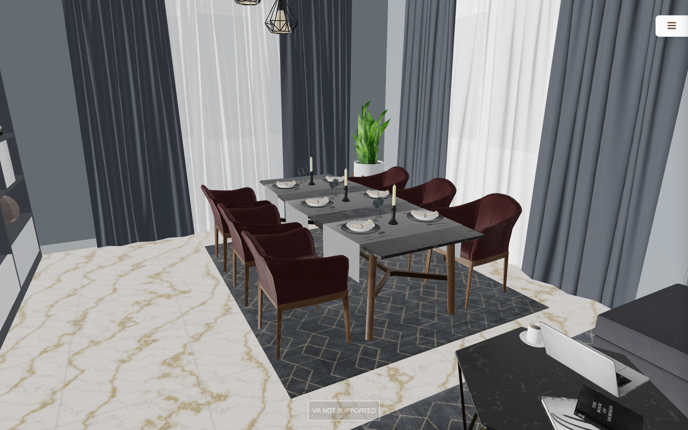
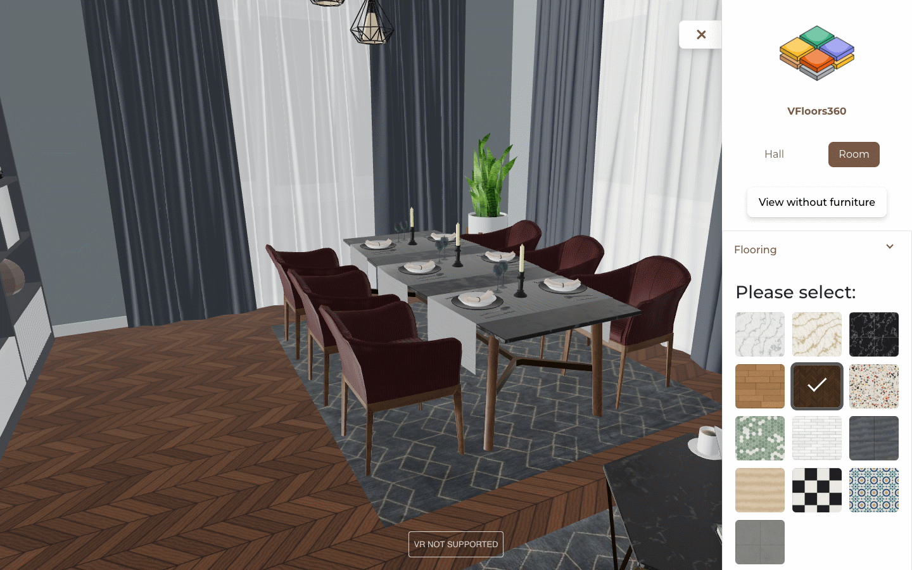
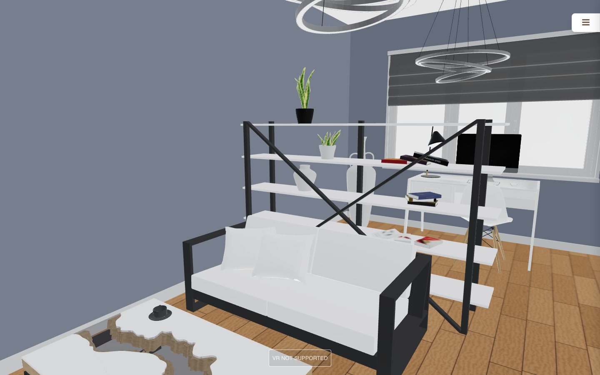
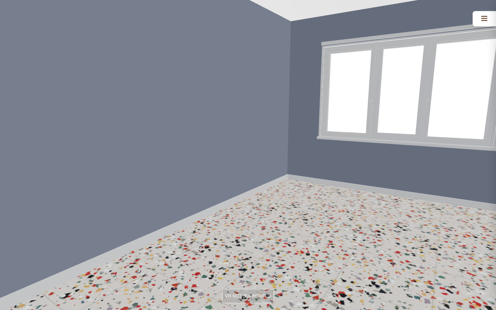
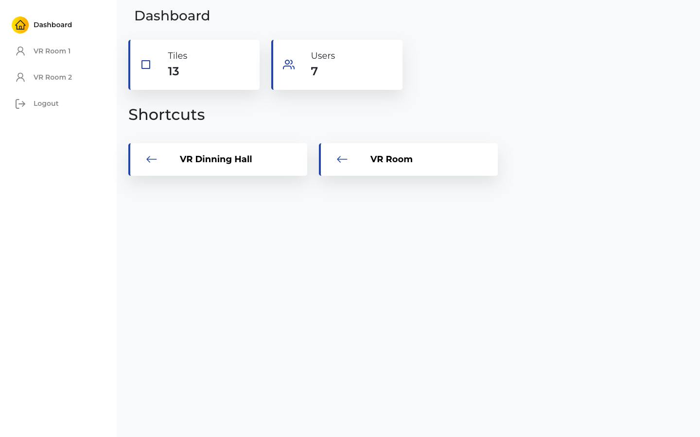
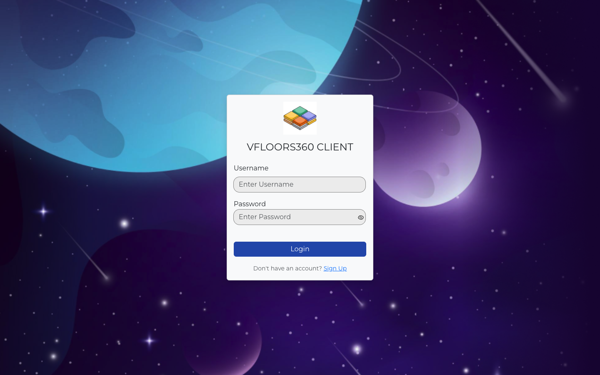

# VFloors360-Client

**VFloors360-Client** is the front-end component of the VFloors360 project, a 360-degree room visualization platform designed for immersive VR experiences. This module allows users to explore TPT's tile catalog in realistic virtual environments, such as kitchens and bathrooms, powered by WebXR, React, and Three.js.

## 🌐 Project Overview

VFloors360-Client provides users with an intuitive and interactive way to visualize various tile options in 3D-modeled rooms using Meta Quest 2 and compatible web browsers. It leverages `@react-three/fiber`, `three.js`, and `leva` to manage scenes, controls, lighting, and interactions.

---

## 📸 Screenshots

Screens from a local run against [VFloors360-Server](https://github.com/khalid-syfullah/VFloors360-Server) with sample tiles (generated textures) and the 3D scenes in this repo.

<table>
  <tr>
    <td align="center" valign="top">
      <br>
      <b>Dining hall in 3D</b><br><sub>Calacatta Gold marble on the floor</sub>
    </td>
    <td align="center" valign="top">
      <br>
      <b>Tile catalog</b><br><sub>Pick a tile and the floor changes</sub>
    </td>
  </tr>
  <tr>
    <td align="center" valign="top">
      <br>
      <b>Living room</b><br><sub>Natural oak planks</sub>
    </td>
    <td align="center" valign="top">
      <br>
      <b>Without furniture</b><br><sub>See the whole floor in terrazzo</sub>
    </td>
  </tr>
  <tr>
    <td align="center" valign="top">
      <br>
      <b>Dashboard</b><br><sub>Tile and user counts, scene shortcuts</sub>
    </td>
    <td align="center" valign="top">
      <br>
      <b>Sign in</b><br><sub>Client login</sub>
    </td>
  </tr>
</table>

## 📁 Project Structure

```
VFloors360-Client/
├── public/
│   └── assets/        # Tile textures, images, and videos
├── src/
│   ├── components/    # UI components like Navbar, Instructions, etc.
│   ├── scenes/        # VR room scenes and 3D canvas setup
│   ├── textures/      # Texture loaders and maps
│   ├── App.js         # Main application entry
│   └── index.js       # ReactDOM render entry
├── package.json
└── README.md
```

---

## 🛠️ Technologies Used

- **React** — UI library for building user interfaces.
- **Three.js** — 3D engine for rendering the VR environment.
- **@react-three/fiber** — React renderer for Three.js.
- **Leva** — GUI controls for real-time parameter adjustments.
- **Redux** — State management for application data.
- **Axios** — API request handling.
- **GLTFLoader / DRACOLoader** — For importing and optimizing 3D models.
- **Meta Quest 2** — Target VR device for performance testing.

---

## 🚀 Getting Started

### Prerequisites

Ensure the following are installed:

- `Node.js >= 18.x`
- `npm >= 9.x`

### Installation

```bash
git clone https://github.com/khalid-syfullah/VFloors360-Client.git
cd VFloors360-Client
npm install
```

### Running the Development Server

```bash
npm start
```

> Open your browser at `http://localhost:3000`

---

## 🧱 Key Features

- 📦 **GLTF/GLB Model Integration**: Realistic 3D room scenes with furniture and lighting.
- 🧭 **Interactive Navigation**: Orbit controls and clickable floor navigation circles.
- 🎨 **Dynamic Texturing**: Select and preview tile textures in real-time.
- 💡 **Customizable Lighting**: Leva controls for adjusting ambient, directional, and spotlight properties.
- 🧪 **VR Optimization**: Runs on Meta Quest 2 with high-performance baked lighting and texture optimization.

---

## 🔐 API Integration

- **GET /api/tiles** — Fetch available tiles including texture data.
- **Asset Handling** — Loads textures dynamically from `/assets/floors/` and renders them on models.

---

## 🧪 Testing

- ✅ **Unit Testing** — Tests for individual components.
- 🔄 **Integration Testing** — Validation of component interactions.
- 📈 **Performance Testing** — VR scene framerate and asset load time benchmarks.
- 🧪 **Usability Testing** — Conducted on Meta Quest 2 to ensure intuitive UX.

---

## 🔧 Future Enhancements

- 🎤 **Voiceover Support** — Audio instructions via Google TTS or AWS Polly.
- 🛡️ **API Security** — OAuth 2.0, JWT, and input validation to safeguard user data.
- 🛋️ **Furniture Customization** — Interactive model replacement and color selection.

---

<!-- CONTRIBUTING -->
## Contributing

Follow these steps to fork and create a pull request:

### 🛠 Steps to Contribute

1. **Fork** the repository by clicking the "Fork" button on the top right of the [main repo page](https://github.com/Khalid-Syfullah/VFloors360-Client).
2. **Clone** your forked repository to your local machine:
   ```bash
   git clone https://github.com/your-username/VFloors360-Client.git
   cd VFloors360-Admin
   ```
3. **Create a new branch** from `main`:
   ```bash
   git checkout -b your-username/feature-name
   ```
4. **Make your changes** and commit them:
   ```bash
   git add .
   git commit -m "Describe your changes"
   ```
5. **Push your branch** to your fork:
   ```bash
   git push origin your-username/feature-name
   ```
6. **Open a Pull Request** on GitHub:
   - Go to your forked repository.
   - Click "Compare & pull request".
   - Ensure the base repository is `Khalid-Syfullah/VFloors360-Client` and the base branch is `main`.
   - Add a clear title and description of your changes.
   - Submit the PR!

---


### 📌 Guidelines

- Keep your commits atomic and descriptive.
- Follow existing coding conventions.
- If you're unsure, open an issue first to discuss the change.

---


<!-- ROADMAP -->
## Roadmap

See the [open issues](https://github.com/khalid-syfullah/VFloors360-Client/issues) for a list of proposed features (and known issues).

---


## 📜 License

MIT © [khalid-syfullah](https://github.com/khalid-syfullah)

---

## 👤 Author

Developed by [Khalid Syfullah](https://github.com/khalid-syfullah)

---

